  

# 🏷️ Awesome Dynamic Pricing & CPQ

  
  
  
  
  

> 🚀 A curated directory of enterprise SaaS platforms, open-source pricing engines, and Configure-Price-Quote (CPQ) software tools for revenue operations, B2B sales automation, and dynamic monetization.

---

## 📑 Table of Contents
- [📊 Sector Overview & Market Dynamics](#-sector-overview--market-dynamics)
- [☁️ SaaS & Hosted CPQ Platforms](#️-saashosted-platforms)
- [💻 Open-Source GitHub Projects](#-open-source-github-projects)
- [🏗️ Key Architectural Considerations](#️-key-architectural-considerations)
- [📈 Star History](#-star-history)
- [🤝 Support & Community](#-support--community)
- [✍️ How to Contribute](#️-how-to-contribute)
- [⚖️ Disclaimer](#️-disclaimer)

---

## 📊 Sector Overview & Market Dynamics

The global Configure, Price, Quote (CPQ) and dynamic pricing software market is valued at approximately **$3.6 billion to $4.1 billion in 2026** and is projected to expand to **$7.5 billion–$8.1 billion by 2030–2031**, charting a robust **15%–21% CAGR** driven by cloud transitions, hybrid monetization models, and agentic AI quoting workflows. 

The market dynamics exhibit a **moderately fragmented, bifurcated structure** rather than a pure winner-take-all monopoly: mega-cap CRM platforms (Salesforce, Microsoft Dynamics) anchor enterprise CRM-native quoting suites, while highly specialized leaders (PROS, Pricefx, DealHub, Vendavo) capture complex manufacturing, multi-channel distribution, and multi-dimensional subscription workflows through composable APIs and algorithmic margin optimization.

---

## ☁️ SaaS/Hosted Platforms

The table below catalogs premier hosted CPQ and pricing optimization platforms, sorted in descending order by parent company scale (market capitalization or private enterprise valuation / revenue).

| Product | 🏢 Company Scale (Valuation / Revenue) | 📝 Description | 💵 Starting Pricing (Specific Tier) | 🎁 Free Tier / Trial Limits |
|:---|:---|:---|:---|:---|
| **[Salesforce CPQ & Revenue Cloud](https://www.salesforce.com/)** | **~$250B Market Cap** ($37.9B FY25 Revenue) | ⚡ Enterprise CPQ and Revenue Lifecycle Management benchmark providing guided selling, configuration constraints, approvals, and order generation. | **$75/user/month** (Standard CPQ list, annual contract); CPQ Plus at **$150/user/month**; Billing billed at % of invoiced volume | **90-Day Evaluation** org via Salesforce CPQ Developer Edition / Trailhead Playground; no standard public free tier (custom sales PoC for Revenue Cloud) |
| **[Zoho CRM (CPQ)](https://www.zoho.com/crm/)** | **~$12.5B Valuation** ($1.4B+ FY25 Revenue, bootstrapped) | 📦 Built-in CPQ rules, product configurator, line-item discounts, and automated quote generation integrated into Zoho's CRM suite. | **$23/user/month** (Professional tier, billed annually) or **$35/user/month** (billed monthly) | **15-Day Free Trial** with full Professional/Enterprise feature access (no credit card required); permanent Free Edition exists for 3 users but excludes CPQ features |
| **[Conga CPQ](https://www.conga.com/)** | **~$2.5B Valuation** (~$400M+ Revenue; Thoma Bravo / Apttus) | 📑 Enterprise Configure-Price-Quote suite (formerly Apttus CPQ) tailored for complex multi-tier product bundles, contract lifecycles, and Salesforce-heavy workflows. | **$85/user/month** (Software Advice entry benchmark, custom enterprise annual agreement) | **No self-service free tier or trial**; evaluations conducted via tailored private vendor demos and guided PoC environments |
| **[Revalize FPX CPQ](https://www.revalize.com/products/fpx-cpq/)** | **~$1.8B Valuation** (~$42M–$99M ARR; Hg Capital & TA Associates) | 🏭 Heavy industrial and manufacturing Select-Configure-Price-Quote (SCPQ) engine built for multi-tiered distribution channels and complex engineering constraints. | **$150/user/month** (SelectHub entry estimate, custom enterprise agreement) | **No self-service free trial or free tier**; access provided via scheduled custom product demonstrations and technical scoping sessions |
| **[PROS Smart CPQ](https://www.pros.com/)** | **~$1.4B Acquisition Value** (~$360M Revenue; Thoma Bravo) | 🤖 AI-powered configure-price-quote and dynamic price optimization platform optimizing margin protection across millions of B2B SKU combinations. | **Private Offer / Azure Marketplace** (Single-module entry benchmark starts at ~$60,000–$75,000/year; MACC eligible) | **No public self-service free trial or free tier**; custom guided pilot programs and sandbox proofs-of-concept arranged via sales |
| **[Pricefx](https://www.pricefx.com/)** | **~$700M–$1B Est. Valuation** ($131M Total Raised; Apax Digital) | 🎯 Cloud-native pricing software platform covering modular price optimization (Plan, Price, and Profit), AI segmentation, dynamic CPQ, and rebate management. | **Plan Package: Free** ($0 recurring software fee for analytics); Price & Profit tiers start at ~$75,000–$100,000/year based on Revenue Under Management (RUM) | **Plan package is 100% free forever** for baseline pricing analytics and margin leakage reporting; advanced Price/Profit tiers offer no public free trial (sales demo/PoC only) |
| **[Vendavo](https://www.vendavo.com/)** | **~$500M–$750M Est. Valuation** (~$100M ARR; Francisco Partners & Accel-KKR) | 🛡️ Commercial excellence platform offering AI-driven deal price guidance, CPQ, rebate governance, and price waterfall leak prevention for distributors and manufacturers. | **$75/user/month** (Capterra entry benchmark for Pricepoint module; full enterprise deployments start at ~$75,000/year) | **No self-service free trial or free tier**; commercial pilots and custom demo environments require an engagement agreement |
| **[DealHub](https://dealhub.io/)** | **~$450M–$600M Est. Valuation** ($184.5M Raised, $60M+ ARR; Riverwood Capital) | 💼 Next-generation agentic quote-to-revenue platform combining CPQ, CLM, DealRoom, and subscription billing in a CRM-agnostic, headless architecture. | **~$28,000/year** (Vendr median contract benchmark for entry Growth CPQ tier; ~15%–25% multi-year discount typical) | **No self-service free trial or free tier**; vendor provides live interactive DealRoom product demos and guided implementation pilots |
| **[Experlogix CPQ](https://www.experlogix.com/)** | **~$150M–$250M Est. Valuation** (~$20M Revenue; Featheringill Capital) | ⚙️ Specialized CPQ and document automation engine engineered for Microsoft Dynamics 365, NetSuite, and Salesforce with complex multi-level BOM rules. | **~$20,000/year** (SelectHub benchmark; Document Automation add-on from **$12/user/month** with 10-user minimum base) | **No self-service free trial or free tier**; interactive live demonstrations and custom configuration workshops available on request |
| **[QuoteWerks](https://www.quotewerks.com/)** | **Bootstrapped SMB Leader** (Aspire Technologies; 11–50 employees, 85k+ users) | 🖥️ Turnkey quoting and CPQ software for IT solution providers, MSPs, and VARs featuring real-time distributor pricing integrations across 15+ vendors. | **$14/user/month** (Standard edition, concurrent licensing model, annual subscription); Professional at **$21/user/month**; Corporate at **$30/user/month** | **30-Day Free Trial** of QuoteWerks Web with full feature capabilities and unlimited quote/template creation (no credit card required) |

---

## 💻 Open-Source GitHub Projects

Open-source alternatives provide self-hostable pricing logic, usage metering, rating pipelines, and configure-price-quote engines without per-seat enterprise licensing fees. Projects are ordered below in descending order by GitHub star count.

| Project | ⭐ Stars | 🛠️ Tech Stack | 📜 License | 🔍 Description |
|:---|:---:|:---|:---|:---|
| **[Lago](https://github.com/getlago/lago)** |  | Ruby / Go / TypeScript | AGPL-3.0 | 📊 **Open-source metering and usage-based billing engine.** Operates as an API-first monetization infrastructure handling real-time event ingestion, dynamic consumption tracking, subscription management, complex tiered rating, and automated invoice delivery. |
| **[Invoice Ninja](https://github.com/invoiceninja/invoiceninja)** |  | PHP (Laravel) / Flutter | Elastic-2.0 | 🧾 **Source-available quoting, invoicing, and proposal suite.** Generates dynamic quotes with approval workflows, online deposits, automatic conversion from quote to invoice, multi-currency support, and payment gateway routing. |
| **[Crater](https://github.com/crater-invoice/crater)** |  | PHP (Laravel) / Vue.js | MIT | 💼 **Open-source invoicing and quotation platform for SMBs.** Allows businesses to track expenses, configure price books, issue comprehensive estimates/quotes with custom tax rates, and convert estimates into trackable invoices. |
| **[Flexprice](https://github.com/flexprice/flexprice)** |  | Go / React / PostgreSQL | Apache-2.0 | ⚡ **Developer-first pricing and billing infrastructure.** Tailored for usage-based, subscription, and hybrid monetization models. Provides low-latency event metering, prepaid wallet credits, entitlement checks, and automated invoicing. |
| **[Kill Bill](https://github.com/killbill/killbill)** |  | Java | Apache-2.0 | 💳 **Enterprise-grade open-source subscription billing and payments platform.** Handles complex recurring catalog rules, multi-tier pricing plans, add-on dependencies, custom invoices, payment routing, and dunning management. |
| **[Lotus](https://github.com/uselotus/lotus)** |  | Python (Django) / TypeScript | MIT | 🎛️ **Open-source pricing and packaging control plane.** Sits between the quote-to-cash application layer to run pricing experiments, manage feature entitlements, analyze customer usage trends, and deploy custom subscription matrices. |
| **[Meteroid](https://github.com/meteroid-oss/meteroid)** |  | Node.js / TypeScript | AGPL-3.0 | ⏱️ **Modern pricing and billing infrastructure for SaaS.** Covers the entire cycle from formal quotes and contract digital signatures to automated event metering, versioned plan packaging, and payment collection. |
| **[openCPQ](https://github.com/webXcerpt/openCPQ)** |  | JavaScript / React | MIT | 🧩 **Client-side open-source CPQ product-configuration framework.** Models complex product constraint rules and dynamic BOM pricing directly in JavaScript/React without requiring round-trips to an enterprise backend. |
| **[flexprice-front](https://github.com/flexprice/flexprice-front)** |  | React / TypeScript / Vite | Apache-2.0 | 🖥️ **Official frontend dashboard for Flexprice.** Provides an intuitive administration UI to configure pricing plans, define billable metrics, audit customer usage graphs, and issue manual or scheduled quotes. |
| **[Higson Insurance BRE](https://github.com/higson-io/business-rules-motor-insurance)** |  | Java | Apache-2.0 | 🚗 **Sample dynamic pricing engine powered by Higson Business Rules Engine (BRE).** Illustrates high-performance calculation of responsive quotations and policy pricing based on multi-dimensional decision tables and math algorithms. |
| **[Haute](https://github.com/PricingFrontier/haute)** |  | Python / Polars / MLflow | Apache-2.0 | 📐 **Open-source pricing engine and rating pipeline.** Designed for complex mathematical scoring, machine learning rating pipelines, margin optimization, and exposing price models as high-throughput REST APIs. |
| **[SwiftCPQ](https://github.com/christopher-talke/SwiftCPQ)** |  | Vue.js / JavaScript | MIT | 🚀 **Lightweight open-source CPQ proposal and quote builder.** Vendor-agnostic sales tool designed for MSPs and IT consultancies to quickly generate standardized product configurations, quotes, and PDF proposals. |
| **[Apto.ONE Core](https://github.com/confirado/apto-one-core)** |  | PHP (Symfony) | Proprietary / Source-Available | 🛠️ **Open product configurator backend.** Powers guided selling rules, component dependency matrices, 2D/3D visual configuration adapters, and real-time surcharge/discount calculations during interactive product builds. |

---

## 🏗️ Key Architectural Considerations

When evaluating between commercial CPQ SaaS and self-hosted open-source pricing infrastructure, evaluate:

1. **Rule Engine Complexity vs. Code Velocity**:
   - Commercial suites (Salesforce CPQ, Conga) offer declarative rule builders suited for non-technical revenue operations teams, but introduce technical debt and deployment overhead.
   - Open-source engines (openCPQ, Haute, Flexprice) offer code-first agility and sub-millisecond calculation speeds, but require internal developer maintenance.
2. **Hybrid Monetization (Seats + Usage)**:
   - Modern B2B models blend user subscriptions with consumption metrics. Metering engines like **Lago** or **Flexprice** can be paired with CPQ proposal frontends (like **DealHub** or **Invoice Ninja**) to bridge contract creation with continuous rating.
3. **Margin Protection & Discount Drift**:
   - Advanced AI pricing platforms (PROS, Vendavo, Pricefx) excel at eliminating margin leakage through algorithmic floor/ceiling rules and cross-customer price elasticity modeling.

---

## 📈 Star History

---

## 🤝 Support & Community

Thank you for exploring and using this curated dynamic pricing and CPQ directory! 💖 

If you find this repository valuable:
- ⭐ **Star** this repository on GitHub to help others discover it.
- 🍴 **Fork** it to keep a personal copy or contribute new tools.
- 📢 **Share** it with fellow revenue operations teams, pricing managers, and developers.
- ☕ **Support the maintainer**: If you'd like to support ongoing curation and maintenance, consider buying a coffee via the [GitHub Sponsors Dashboard](https://github.com/sponsors/ishandutta2007).

---

## ✍️ How to Contribute

We welcome community contributions, additional open-source pricing engines, and verified SaaS pricing updates:

1. 🍴 Fork this repository.
2. 📝 Add or update tool entries in [README.md](file:///C:/Users/ishan/Documents/Projects/Awesome-Dynamic-Pricing-CPQ/README.md).
3. 🎯 Ensure all table columns match existing standards: include verified starting price tiers, specific free trial/tier limits, company valuation/scale, and valid GitHub stargazer badges.
4. 🚀 Open a Pull Request with verifiable documentation or vendor source links.

---

## ⚖️ Disclaimer

This repository is maintained for research, architectural planning, and educational purposes:
- 📌 Pricing and company valuations reflect public filings, software directory listings (G2, Capterra, Software Advice, SelectHub, Vendr), and market transaction reports.
- 📌 Enterprise CPQ contracts often include variable implementation fees (SOWs) and negotiated discounts (typically 15%–30% below published list). Contact vendors directly for formal enterprise proposals.
